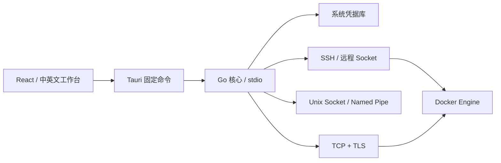

# Docker Workbench 跨平台 Docker 管理器

实现架构说明 · 对应源码 0.1.4 · 操作布局参考 IntelliJ IDEA Services。

## 产品与交付范围

资源结构为“主机 → Compose 项目 → 服务 / 容器”，采用左侧资源树、上方对象标签和服务表、下方详情区。目标系统是 macOS、Windows、Linux；首版优先管理 Linux Docker Engine，界面先支持简体中文、英文。

当前交付包含正式 React 工作台、Go 连接核心、Tauri 桌面壳、macOS arm64 本地安装包、核心与界面测试、三系统 CI 配置和使用文档。`code/index.html` 是保留的早期模拟原型，不代表正式程序的数据来源。Windows/Linux 安装运行、正式签名公证仍需后续发行验收。

正式应用直连 Docker Engine，运行不依赖 IDEA；不读取或解密 IDEA Password Safe。

## 一、实现架构

采用 Tauri 2 + React / TypeScript + Go。源码位于 `code/`；锁定依赖见 `code/pnpm-lock.yaml`、`code/src-tauri/Cargo.lock`、`code/core/go.sum`。

| 层 | 实现 | 责任 |
|---|---|---|
| 桌面壳 | Tauri 2、薄 Rust | 原生窗口、固定 IPC、文件选择 / 保存、Go 子进程生命周期 |
| 工作台 | React 19、TypeScript、Vite | 多主机树、对象标签、表格、表单、主题和布局 |
| 日志 / 终端 | TanStack Virtual、xterm.js | 有界日志缓冲、虚拟滚动、终端输入输出与 resize |
| 连接核心 | Go、官方 Moby Docker SDK | API 协商、资源与写操作、logs / events / stats / exec |
| SSH | x/crypto/ssh、knownhosts、Agent、ssh_config | 主机验证、认证、复用连接、代理、单级跳板 |
| 数据 | SQLite WAL | 非敏感连接、偏好、Compose 关联、最近 500 条操作 |
| 凭据 | 系统凭据库与会话内存 | 用户主动选择记住时保存密码 / 口令；导出不包含秘密 |

Go 核心通过带请求 ID 的逐行 JSON 与 Rust 通信，不在本机开放 HTTP 管理端口。前端无法调用任意 shell 命令，发行版 CSP 限制网络访问，固定 IPC 方法在 Rust 和 Go 各校验一次。订阅事件携带 connectionId / streamId / containerId，取消和结果与 UI 当前选中对象分离。

Tauri 按目标架构分发外部二进制；各系统仍需分别构建与验证原生依赖。[Tauri sidecar](https://v2.tauri.app/develop/sidecar/)、[前置依赖](https://v2.tauri.app/start/prerequisites/)

## 二、功能状态

| 功能 | 当前实现 | 验收边界 |
|---|---|---|
| 多主机连接 | SSH 密码、OpenSSH 密钥、Agent；Unix / Pipe / TLS | SSH/TLS 自动化验证；Pipe 原生运行待验收 |
| 连接参数 | 超时、Keep-alive、单级跳板、HTTP CONNECT / SOCKS5 | 复杂代理和多系统凭据服务需真实环境补测 |
| 资源管理 | 容器、镜像、网络、卷列表；容器 / 资源 Inspect | 不含镜像构建、推送和文件管理 |
| Compose 分组 | 使用 project / service 标签识别 | 标签不能完整还原原始部署文件 |
| 容器操作 | 启动 / 停止 / 重启、目标预览、逐项记录 | 批量已有容器操作不提供 Compose 依赖健康编排 |
| Compose 部署 | 关联源文件后 Pull / Up / Recreate / Down | 需执行端 Docker Compose CLI；不提供配置 diff 或发布回滚 |
| 日志 | 多来源合并、过滤、时间、跟随、换行、复制 / 导出 | 有界缓冲；重连缺口可见；未做长期高负载压测 |
| 实时资源 | CPU、内存、网络与最近 60 个样本 | 不是历史监控平台 |
| 终端 | xterm、sh/bash、UTF-8、resize、关闭回收 | 原生 Windows 容器 shell 尚未适配 |
| 迁移 | SSH config / Docker contexts 发现、选择、去重；JSON | 不读取 IDEA Password Safe 或任意 ProxyCommand |
| 多语言 | 简体中文 / English、即时切换、持久偏好 | 引擎原始错误、用户资源名和日志保持原文 |
| 桌面体验 | 明暗主题、最多 12 个对象标签、Cmd/Ctrl+K、可调整详情区 | 原生系统菜单遵循 Tauri / 系统语言 |

## 三、连接与 API 兼容

SSH 优先通过到远端 Unix Socket 的通道访问 Docker；若远端禁止此通道，回退固定 `docker system dial-stdio`，后者需要远端 Docker CLI。回退命令显式固定 socket、清理外部 Docker 环境；多路日志通过有界连接池分配会话，最多 8 条认证连接、每条最多 6 个 HTTP 会话，容量不足会明确报错。账户必须有 socket 权限。TCP 仅允许 HTTPS 并验证证书与主机名，不增加无认证 2375 暴露。[Docker SSH 连接](https://docs.docker.com/engine/security/protect-access/)

主机指纹读取应用 known_hosts 与现有 ~/.ssh/known_hosts。未知主机返回 5 分钟的一次性挑战，用户核对后才能保存；已知指纹不符直接阻断，损坏的 known_hosts 也不会忽略。SSH config 支持常用别名、HostName、User、Port、IdentityFile、单级 ProxyJump，拒绝任意 ProxyCommand；PPK 需先转换成 OpenSSH 格式。

官方 SDK 支持自动 API 协商，显式全局 API 环境变量会影响协商，因此核心不加载系统 Docker 环境设置。当前锁定 SDK 支持范围为 1.40–1.56。流程是传输建立 → 探测引擎版本 → 双方范围交集 → 按连接选用版本；手动版本同时验证 SDK 与服务端上下界。[Docker API 文档](https://docs.docker.com/reference/api/engine/)

已用真实 SDK 对隔离服务端验证“最高 1.43 自动选用 1.43，手动 1.52 拒绝”。更低于 SDK 最低版本的引擎会明确拒绝，不能靠改版本字符串伪装兼容。

## 四、写操作与 Compose

所有新建与导入连接默认只读，后端也检查只读状态。交互终端属于写能力。只读是客户端限制；需要强制授权仍依赖服务端权限或代理，不宣称本地记录属于防篡改审计。

容器变更必须先生成具体 ID / 名称 / 主机范围预览，令牌只用一次、2 分钟到期。编辑连接或断开会使旧预览失效。执行时再次检查目标，按主机会话串行变更；网络超时标记未知，不自动重放。每个目标在请求前写 running，完成后保存 succeeded / failed / unknown，界面重新读取引擎状态。

Compose 标签只用于发现与分组。Pull / Up / Recreate / Down 需要关联原始工作目录、files、env files、profiles 与项目名。SSH 在远端执行，本地 Unix / Pipe 在本机执行；TLS 连接没有执行文件通道，因此不支持部署操作。

执行前调用 `docker compose config` 验证并计算解析结果摘要；确认后再次验证摘要，配置变化就阻断并要求重新预览。远端结构化参数逐项 POSIX 转义，固定工作目录、Docker socket 和协商后的 API，清理外部 Docker context。配置正文不保存到 SQLite 或操作预览。

停止保留容器；Down 删除项目容器和相关网络，不添加 `--volumes`。它不是卷清理入口。首版没有自动健康检查、回滚或构建发布流水线替代能力。

## 五、流、取消与存储

非 TTY 日志通过官方 stdcopy 分离 stdout / stderr，TTY 按原始流读取。处理 UTF-8 分块和长行，移除日志 ANSI 控制码后识别级别与显示文本，保留原始时间与来源；按时间与稳定序列合并，过滤常见文本 / JSON 级别，无法识别为 UNKNOWN。时间精度差异有回归测试。

界面按 80ms 批次更新，虚拟滚动，限制 50,000 行 / 约 32 MiB。这里是应用缓冲预算估算，不承诺 JavaScript 进程内存总量为 32 MiB。暂停跟随仅停止滚动。导出当前过滤后的结果；日志不作为 HTML 执行。

流随对象切换、连接断开和窗口关闭取消；Go 退出等待活动流回收，Rust 关闭 stdin 后给予核心正常退出时间，再兜底回收子进程。断线日志有限重试并携带游标，缺口不伪装成完整历史。

SQLite 只存连接元数据、布局、Compose 关联和操作结果；密码 / 口令进入系统凭据库或仅保留在内存。修改连接目标会清理旧目标的凭据引用。导出不包含秘密内容，但包含内部主机和本地密钥路径，应作为内部配置管理。

## 六、多语言实现

语言标识使用 zh-CN / en，首次根据系统语言选择，随后使用 SQLite 中的用户偏好。词条通过 TypeScript 键约束，自动化测试比较词条完整性、英文中未翻译中文和变量替换。界面状态、操作预览、表单、历史动作和错误摘要随语言切换；时间使用本地时区与语言格式。

新增语言时补充词条目录、语言选择项与完整性测试，不在业务组件中复制页面。引擎原始错误与业务日志不自动翻译，保留可排障信息。

## 七、平台、构建与验收

| 平台 | 目标 | 当前证据 |
|---|---|---|
| macOS | 13+ arm64 / Intel | arm64 .app / .dmg 构建运行；Intel Go 核心交叉编译 |
| Windows | Windows 10 / 11 x64 | Go 核心交叉编译；Named Pipe 适配与原生 CI 已配置，桌面运行待验收 |
| Linux | Ubuntu 22.04+ x64 | Go 核心交叉编译；原生 CI 已配置，WebKitGTK / Secret Service 桌面运行待验收 |

CI 参考官方三平台构建依赖，分别执行测试、核心构建、Tauri 打包并上传产物，不创建公开 Release。[Tauri GitHub 构建](https://v2.tauri.app/distribute/pipelines/github/)

当前 macOS 包是本地开发签名，未使用 Developer ID 或公证。Windows/Linux 原生安装验收与签名仍是正式发行的必要条件。历史测试证据见 [实施与验收](实施与验收.md)，当前 CI 结果以仓库 Actions 为准；早期原型验收记录单独保留，内部调研截图不随公开仓库分发。

## 八、软件更新与发行

0.1.4 使用 Tauri updater，固定读取本仓库 GitHub Releases 的 `latest.json`。前端仅可请求检查、安装已检查的更新及重启，不能覆盖更新地址、公钥或版本比较器。传输使用 HTTPS，安装前强制校验签名，不允许自动降级。

正式构建在启动后检查，发现更新仅提示入口，下载安装由用户主动触发；自动检查偏好存于 SQLite。控制器串行处理检查与安装，失败后必须重新检查，避免复用已消耗的更新状态。Windows 安装前关闭 Go 核心，其他平台重启前回收核心及活动流。

发布工作流分别生成 macOS arm64 / Intel、Windows x64、Linux x64 安装包和签名。汇总任务确认四个平台齐全、用 Minisign 验证签名后生成更新清单与 SHA-256 文件；只在全部通过后公开 Release。普通 CI 不持有更新私钥，不生成可分发的签名更新包。Linux 更新面向 AppImage，deb 升级依赖包安装。
